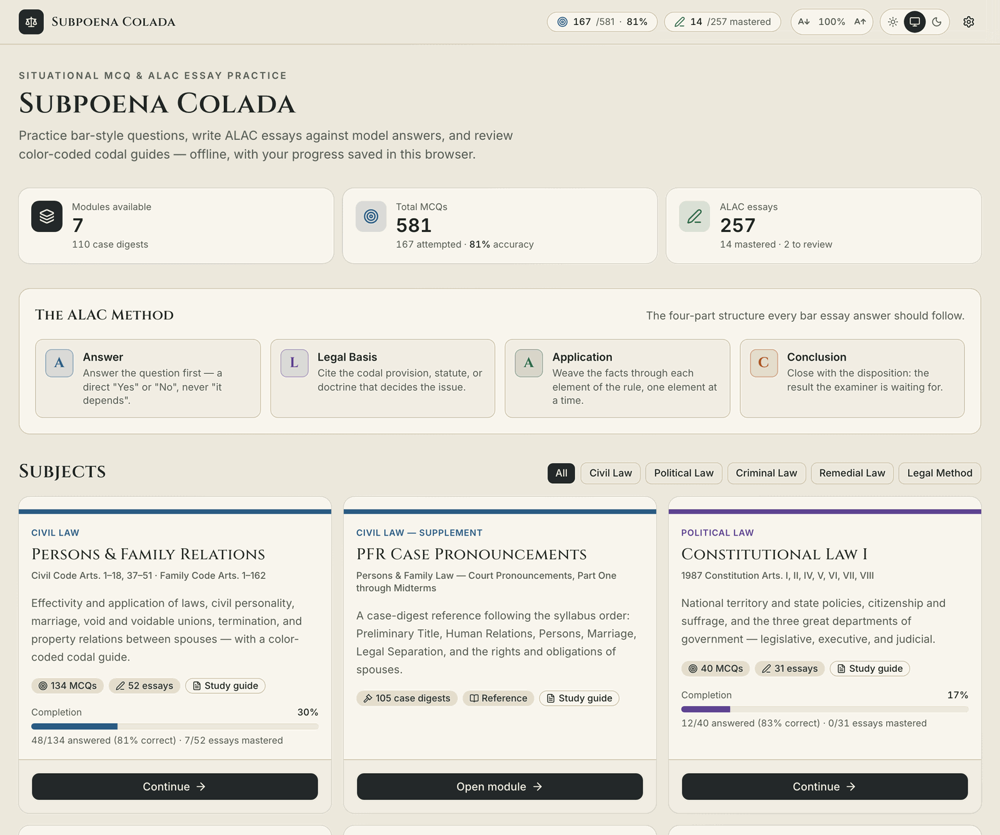
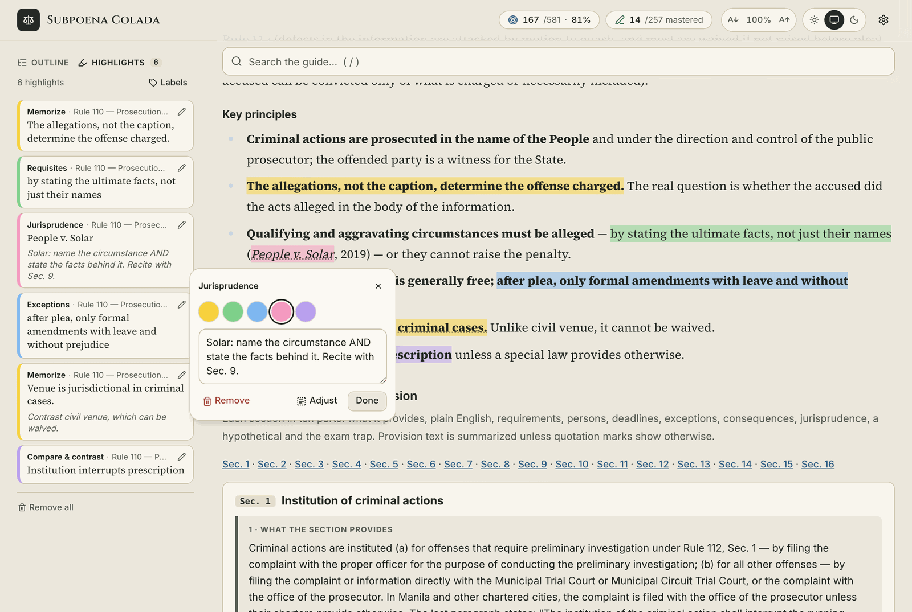
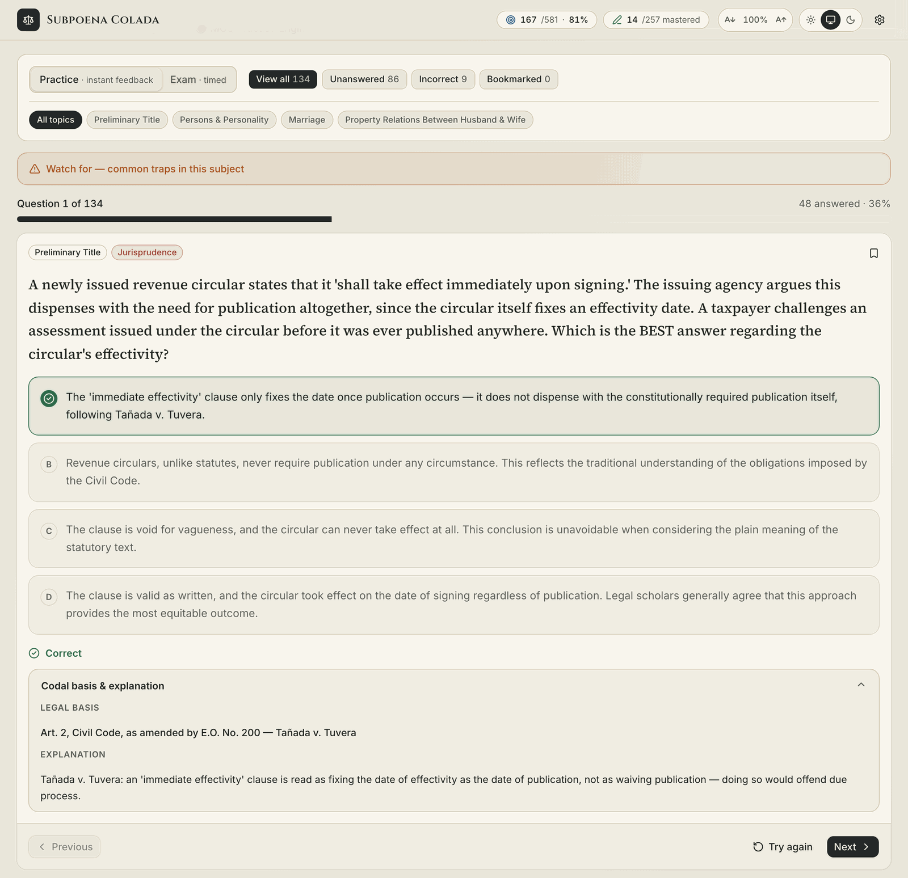
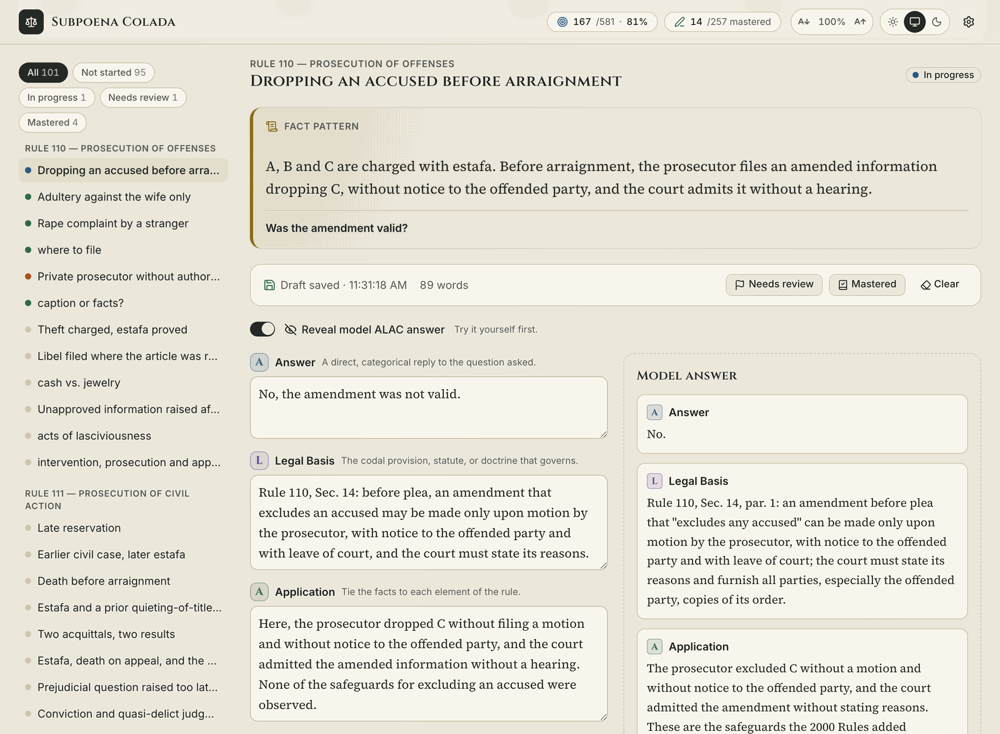
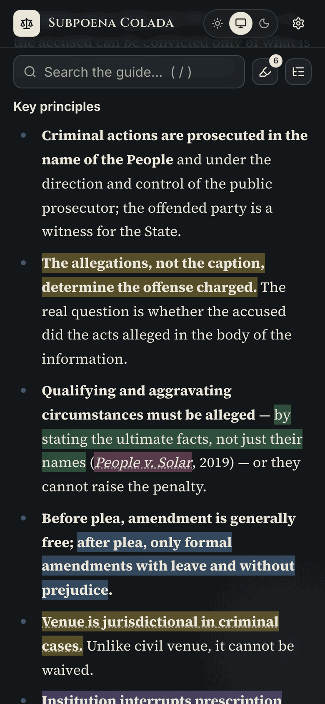

# Subpoena Colada

A study app for Philippine law subjects: color-coded study guides and case digests, situational MCQ practice, and ALAC essay exercises with model answers. There is no account and no server. Everything runs in the browser, and your progress stays in that browser's `localStorage`.

SvelteKit 3 (Svelte 5 runes) · Tailwind v4 · shadcn-svelte.



## Features

### Study guides and case digests



- **Color-coded guides**, with a legend for what each color marks (rules to memorize, requisites, exceptions, jurisprudence and so on).
- **Outline** with scroll tracking, so the sidebar always shows where you are.
- **Search** the whole guide and its case digests. Press `/` to jump to the box, `Enter` / `Shift+Enter` to step through matches. Matches inside collapsed flashcards open automatically.
- **Case digests** grouped by syllabus part and topic. Digests the source flags as unverified carry an *Unverified* badge.
- **Highlights and notes.** Select any text in a guide or digest and pick one of five colors, each with a label you can rename (defaults: Memorize, Requisites, Exceptions, Jurisprudence, Compare & contrast). Tap a highlight, or use the pencil in the Highlights panel, to:
  - change its color or add a note,
  - **Adjust** it to cover different text, keeping the color and note,
  - remove it, or remove every highlight in a subject at once.

  Highlights are anchored to the text they quote, so they survive re-renders and searches. If the guide's wording changes, the highlight moves to *No longer in the guide* with its note intact, and **Re-attach** lets you point it at the new wording.
- **Print-friendly**: printing opens every flashcard and drops the app's controls.

### MCQ practice engine



- **Practice mode** gives instant feedback: the legal basis and an explanation for every item, optional hints, and a *Watch for* box listing the common traps for the subject or topic.
- **Exam mode** is timed and gives no feedback until you submit. Results are scored overall and by topic, then added to your progress.
- **Filters** for unanswered, incorrect and bookmarked questions, plus a filter per topic.
- **Question map** showing which items are correct, incorrect or bookmarked, so you can jump straight to them.
- **Keyboard**: `←` `→` to move, `A`–`D` or `1`–`4` to answer, `N` for the next question once you've answered.

### ALAC essay exercises



- A fact pattern and question for each problem, answered in the four ALAC parts: **A**nswer, **L**egal basis, **A**pplication, **C**onclusion.
- Drafts save as you type, with a word count.
- **Reveal the model ALAC answer** beside your draft once you've tried it yourself.
- Mark problems **Mastered** or **Needs review**, and filter the list by status (not started, in progress, needs review, mastered).

### Progress, settings and devices

<p align="center"></p>

- **Dashboard** with totals, accuracy, essays mastered or flagged for review, and completion per subject. Filter subjects by category: Civil, Political, Criminal, Remedial Law, or Legal Method.
- **Light, dark or system theme**, and a **text size** control that the layout adapts to.
- **Phone layout**: the outline and highlights move into toggles beside the search box.
- **Backups**: Settings exports your answers, drafts, bookmarks and highlights as a JSON file, and imports it on another browser or device. *Reset all progress* clears it all (your theme and highlight labels stay).
- Several open tabs stay in sync.

## Subjects

| Subject | Category | Coverage | MCQs | Essays | Case digests |
| --- | --- | --- | ---: | ---: | ---: |
| Persons & Family Relations | Civil Law | Civil Code Arts. 1–18, 37–51 · Family Code Arts. 1–162 | 134 | 52 | — |
| PFR Case Pronouncements | Civil Law (supplement) | Court pronouncements, Part One through Midterms | — | — | 105 |
| Constitutional Law I | Political Law | 1987 Constitution Arts. I, II, IV–VIII | 40 | 31 | — |
| Criminal Law 1 | Criminal Law | Revised Penal Code, Book One, Arts. 1–15 | 92 | 23 | — |
| Criminal Procedure | Remedial Law | Rules 110–120, from Tiu's 2017 notes, with later rulings flagged | 138 | 101 | — |
| Statutory Construction | Legal Method | Agpalo, Chapters 1–5 | 82 | 8 | — |
| Statutory Construction II | Legal Method | Agpalo, Chapters VI–XI, and five cases | 95 | 42 | 5 |

## Develop

```sh
npm install
npm run dev      # http://localhost:5173
npm run check    # svelte-check
npm run build    # static SPA -> build/ (fallback: 200.html)
```

## Layout

- `src/lib/data/` — one file per subject (`pfr`, `pfr_cases`, `consti1`, `crim1`, `statcon`) plus `modules.ts`, the master index. These files are the source of truth for questions, essays and guides.
- `src/lib/data/statcon2/` — Statutory Construction II (Agpalo Chs. VI–XI and five cases), kept as structured data instead of a hand-written HTML string: one file per chapter (`ch6`–`ch11`), `cases`, `integrated` (comprehensive exam) and `review` (front matter and master sheets), rendered by `model.ts`. True/false items and the case recall drill become MCQs and every ALAC problem becomes an essay, with IDs taken from each item's position in its bank, so add new items at the end of a bank.
- `src/lib/data/crimpro/` — Criminal Procedure, Rules 110–120 (from Tiu's 2017 notes, with later rulings flagged), built on the `statcon2` helpers: one file per Rule (`r110`–`r120`), each rendered by `model.ts` into the same twelve parts; `prescription` (special module after Rule 110); `deadlines`, `cases` and `comparisons` (back matter that indexes the Rule files rather than repeating them); `integrated` (mock exam and its separate key); and `review` (start page, topic map and inventory, last-minute sheet and quality checklist). The same ID rule applies: append new items at the end of a bank.
- `src/lib/stores/storage.svelte.ts` — reactive `localStorage` store (debounced writes, cross-tab sync, export/import).
- `src/lib/highlights.svelte.ts` — anchors reader highlights to quoted text and paints them with the CSS Custom Highlight API, without touching the guide's DOM.
- `src/lib/components/` — `McqQuizEngine`, `AlacEssayEditor`, `StudyGuideViewer`, `HighlightMenu` (the menu over selected or highlighted text), `HighlightsPanel`, `HighlightEditor`, `AlacBanner`, `HeaderNav`.
- `static/legacy/` — the previous single-file HTML version, still served under `/legacy/`.
- `docs/screenshots/` — the images in this README, taken with demo progress.

Question and essay IDs are `<module>:<topic>:<n>` / `<module>:alac:<n>`. Saved progress is keyed by those IDs, so reordering a bank is safe but renaming or renumbering an item detaches its saved answer.

Highlights are anchored inside a guide section's `h2` id or a case digest's id. Renaming those ids, or rewording highlighted text, moves a highlight to *No longer in the guide*, where the reader can re-attach it.

## Deploy

`vercel.json` builds with `npm run build`, serves `build/`, and rewrites unknown paths to `200.html` so `/module/<slug>` deep links work.
